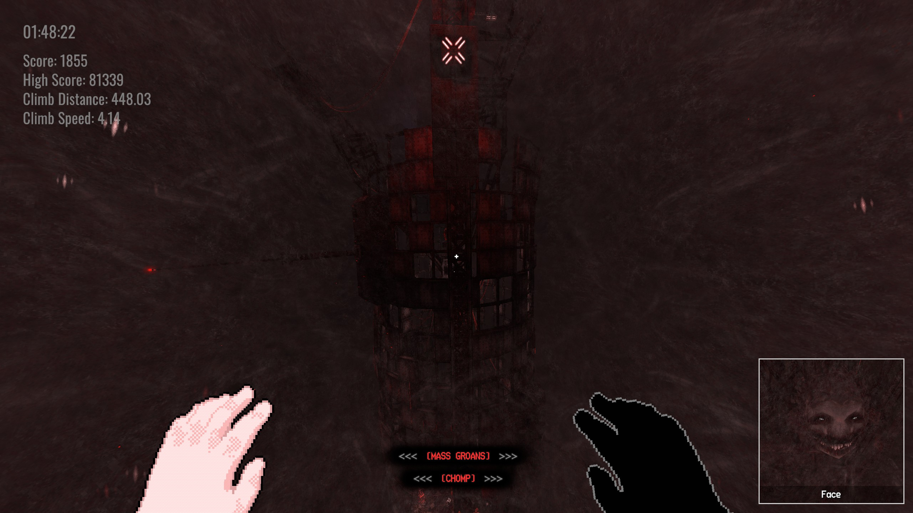
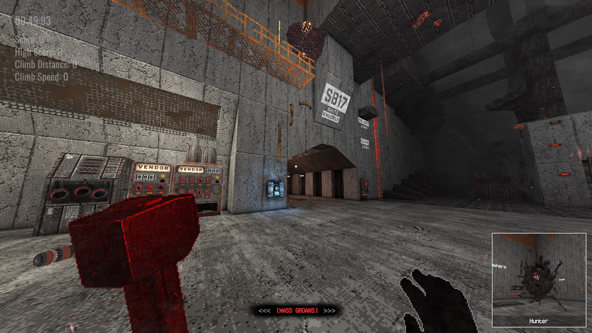

# FaceCam

A [White Knuckle](https://store.steampowered.com/app/3195790/White_Knuckle/) mod: a small streamer camera in the
corner of the screen that tracks whatever is closest and trying to kill you. That's the Mass, Faces, the Hunter, the
Rat King or Remains.

**Download it from Thunderstore:** https://thunderstore.io/c/white-knuckle/p/SlopGaming/FaceCam/




What it does and every setting are in the [Thunderstore README](thunderstore/README.md).

## Building

You need the .NET SDK (6 or newer), White Knuckle, and a Thunderstore Mod Manager (or r2modman) profile with
BepInEx installed.

1. Point the build at your files. Either edit the paths at the top of `FaceCam.csproj`, or pass them on the command
   line:

   ```
   dotnet build -c Release -p:GameDir="C:\Program Files (x86)\Steam\steamapps\common\White Knuckle" -p:BepInExDir="%APPDATA%\Thunderstore Mod Manager\DataFolder\WhiteKnuckle\profiles\Default\BepInEx"
   ```

   `GameDir` is used for the game's assemblies, `BepInExDir` for BepInEx and Harmony.
2. Build:

   ```
   dotnet build -c Release
   ```

   Add `-p:Deploy=true` to copy the plugin into that profile for testing. Don't do that while the Thunderstore
   release is installed there: they share a folder.
3. Make the Thunderstore zip:

   ```
   ./pack.ps1
   ```

   It builds and writes `dist/SlopGaming-FaceCam-<version>.zip`. The version comes from
   `thunderstore/manifest.json`.

## Layout

| Path | What |
|---|---|
| `src/` | The plugin. `FaceCamPlugin.cs` finds threats, aims the camera and draws the feed; `RemainsVisibilityPatch.cs` keeps Remains from freezing while the feed looks at them. |
| `thunderstore/` | Thunderstore manifest, README, changelog and icon. |
| `docs/` | Screenshots and notes. |
| `pack.ps1` | Builds and packages the Thunderstore zip. |

## Credits
- White Knuckle by Dark Machine Games.
- [BepInEx](https://github.com/BepInEx/BepInEx) and [Harmony](https://github.com/pardeike/Harmony).
- Code written with Claude Code (Anthropic's Claude) and Universal Modder. No AI-generated art or audio.

Not affiliated with Dark Machine Games. This repository contains no game code or assets; building it needs your own
copy of White Knuckle.

## License
[MIT](LICENSE)
